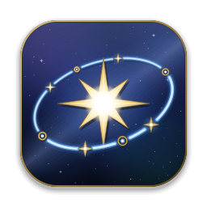
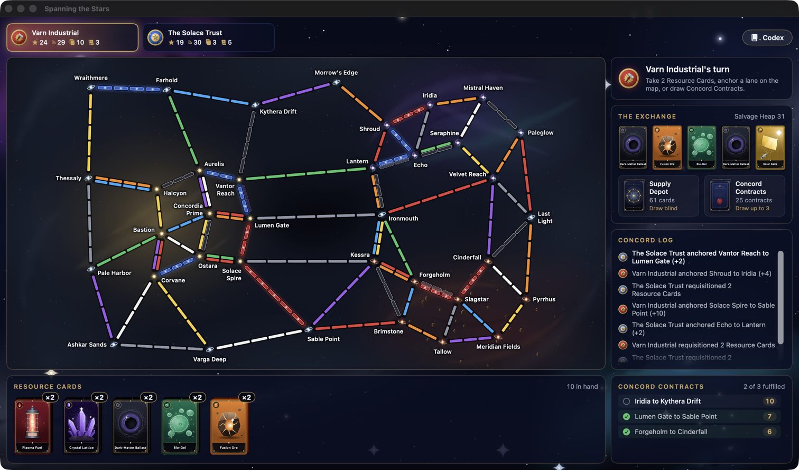

<div align="center">



# Spanning the Stars

**A pass-the-laptop strategy game for macOS: claim hyperspace lanes, fulfil contracts, outbuild rival houses.**

[The story](#the-story) • [Quick start](#quick-start) • [How to play](#how-to-play) • [Development](#development)

</div>

---

Spanning the Stars is a native macOS board game for 2 to 5 players sharing one Mac. Rival shipping houses race to connect star systems on a galaxy map with an optional Frontier Hazards variant. Each House can be played by a human or by an offline AI at one of five difficulty levels. It is written in Swift and SwiftUI with no external dependencies.



## The story

> *The galaxy has been dark for three hundred years. Now the lanes are opening.*
>
> *Claim hyperspace corridors, fulfill contracts for desperate worlds, and outbuild your rivals to forge the greatest network in the known stars. But every lane you anchor is one your rivals can't use, and space is not as big as it looks.*
>
> *The Concord is watching. Start spanning the stars.*

It is the year 3127. For centuries humanity was scattered across the galaxy in isolated colonies, cut off from each other after the collapse of the old Hyperspace Authority. Each system survived on its own, developing its own culture, technology, and trade goods, but travel between them was slow, dangerous, and rare.

That changed when engineers on the mining world of Kessra rediscovered **lane-anchor technology**: a way to stabilize fixed corridors through hyperspace between two star systems. Once an anchor is set at both ends, ships can travel that lane safely and quickly. The catch is that each corridor takes huge resources to build, and only one company can hold the anchor rights to a given lane.

The newly formed **Concord of Systems** has opened the galaxy to development. It has issued charters to a handful of rival shipping houses and given them one mandate: *connect the stars.* Whichever house builds the most valuable network by the end of the Charter Era will be named the official carrier of the Concord, and with that comes control of galactic trade for generations.

You lead one of those houses.

### The rival houses

- **Varn Industrial** (red): blue-collar haulers from the forge worlds. Practical and relentless.
- **The Solace Trust** (blue): old-money financiers who see every lane as an investment.
- **Meridian Collective** (green): a cooperative of agricultural colonies trying to feed the galaxy.
- **House Ashkar** (yellow): desert-world traders with a reputation for cutthroat deals.
- **The Pale Fleet** (black): former military logistics officers who went private after the collapse.

### The map

- **The Core Worlds**: dense, wealthy, crowded with short competitive lanes.
- **The Shattered Rim**: remote frontier systems with long, expensive routes worth big points.
- **The Veil Nebula**: a dangerous zone where interference scrambles single-resource anchors.
- **The Ember Belt**: mining colonies and gravity wells.
- **The Silent Expanse**: an empty gulf in the middle of the map that forces players to commit to long lanes or route around it.

## Quick start

The game requires macOS 26 or later. Download the Apple silicon build from [GitHub Releases](https://github.com/psenger/spanning-the-stars/releases). To build from source, install Swift 6.2 or later through Xcode or the command line tools.

```bash
swift run SpanningTheStars
```

To build a double-clickable app instead:

```bash
scripts/bundle.sh
open "build/Spanning the Stars.app"
```

`scripts/bundle.sh` makes a release build, renders the icon, and assembles an ad-hoc signed `build/Spanning the Stars.app`.

## How to play

On your turn you take exactly one action: requisition Resource Cards, anchor one lane, or accept new Contracts. Anchoring lanes earns Concord Standing, fulfilled Contracts add to it, unfulfilled Contracts subtract from it, and the longest continuous span wins the Great Span Award. The Charter Era ends soon after any house runs down to 2 or fewer Anchor Beacons.

The full rules are in [The Concord Codex](docs/RULES.md), which is also readable inside the game.

### Frontier Hazards variant

An optional toggle at setup that changes two regions of the map. It is original to this game.

- **Spectrum Lanes** (Veil Nebula): pay one card of a different color for each slot.
- **Gravity Well Lanes** (Ember Belt): pay one fewer card than the lane's length, and lose one extra Anchor Beacon.

### In the app

- **Hot-seat privacy.** A full-screen hand-off screen hides each hand between turns, and a loaded or resumed game always opens on it.
- **Saves.** Up to 5 named saves, plus an autosave after every move with Continue Charter on the title screen. File menu: Command-N, Command-O, Command-S.
- **Replay logs.** An optional setting, off by default, writes a JSON Lines log of every action. The engine is deterministic, so a log replays the exact game.
- **Color-blind support.** Each resource has its own symbol as well as its color.

## Development

```bash
swift test
```

The package includes:

- `StarsCore`: the rules engine, map, scoring and saves. Pure Swift with no SwiftUI import, and deterministic under a seeded random number generator.
- `SpanningTheStars`: the SwiftUI app, the SVG art, and the bundled copy of the rules.
- `Tournament`: the command-line runner for seeded bot matches and the difficulty ladder.

`Package.swift` opens directly in Xcode. The art is hand-authored SVG in `Sources/SpanningTheStars/Resources/Art`. After changing `Sources/SpanningTheStars/Resources/AppIcon.svg`, refresh the icon at the top of this page with:

```bash
scripts/make-icon.sh --readme
```

Design notes are in the [design document](docs/superpowers/specs/2026-11-20-spanning-the-stars-design.md).

---

<div align="center">

**The Concord is watching. Start spanning the stars.**

[Rules](docs/RULES.md) • [Design document](docs/superpowers/specs/2026-11-20-spanning-the-stars-design.md) • [Changelog](CHANGELOG.md)

</div>
